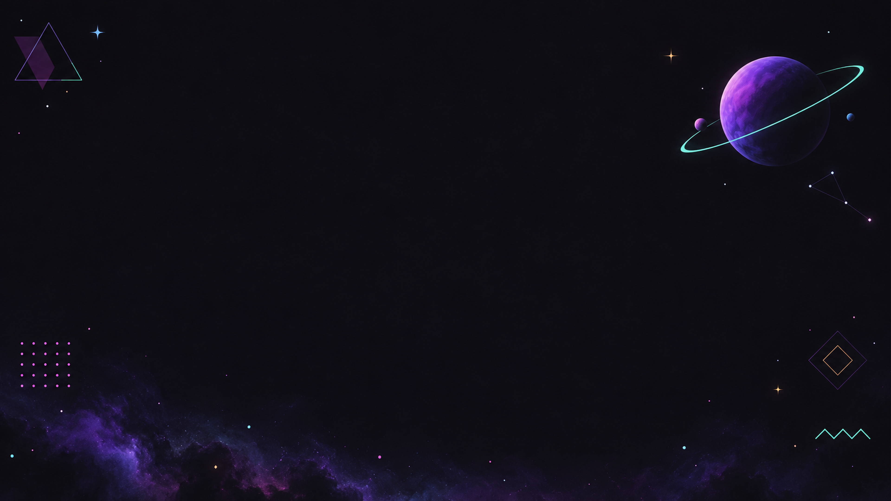

# Wallpapers

Four Aura space wallpapers, 3840 × 2160. Each keeps the middle of the screen dark and calm, with the
detail pushed out to the edges, so windows and the home-screen panel sit on a quiet background.

`install.sh` links the files in this folder to `~/Pictures/wallpapers/`; this README stays in the repository.

## aura-space-1 · Purple nebula

The desktop default. A ringed purple planet in the upper right, a purple nebula sweeping along the
edges, mint and pink orbit accents.

## aura-space-2 · Mint orbit

Mint dominant: a crescent planet in the upper left with thin orbit rings, and a teal nebula along the
bottom edge. Also the lock screen's background before the card redesign.

## aura-space-3 · Sunset rocket

Orange and pink: small planets around the edges and a rocket trailing a curved orange/pink arc.

## aura-space-4 · Minimal

Almost all dark, with one small purple planet with a mint ring and a faint violet haze. The quietest
of the four.

## Using them

| Where | File | Setting |
|---|---|---|
| Desktop | `.config/hypr/hyprpaper.conf` | `path = ~/Pictures/wallpapers/aura-space-1.png` |
| Lock screen (blurred behind the card) | `.config/hypr/hyprlock.conf` | `path` in the `background` block |

hyprpaper picks up a changed `hyprpaper.conf` at the next login, or run `systemctl --user restart hyprpaper`.

## How they were made

AI-generated with an image-generation tool from the prompts in
[`aura-space-prompts.txt`](aura-space-prompts.txt): flat vector art in the Memphis style, using the
Aura palette (`#15141b` background; `#a277ff`, `#61ffca`, `#ffca85`, `#f694ff`, `#82e2ff`,
`#ff6767` accents), no text, with the centre 45% left empty. The tool rendered them at 1672 × 941,
and they were upscaled to 3840 × 2160.
