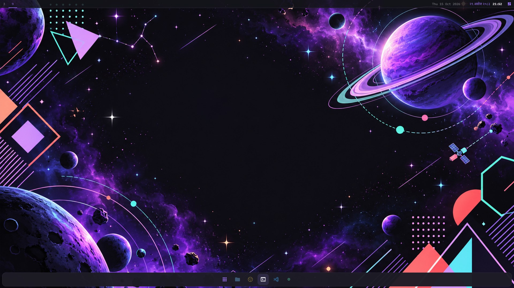
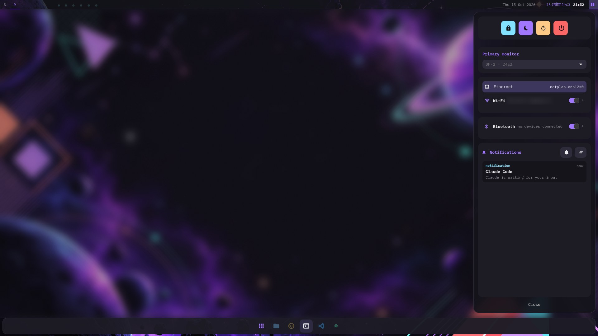
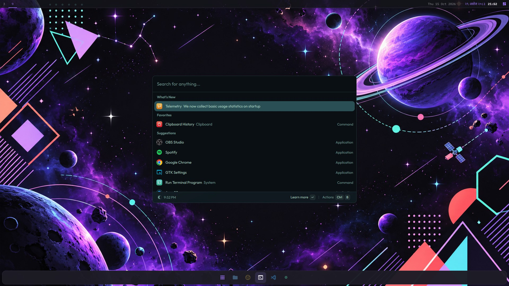
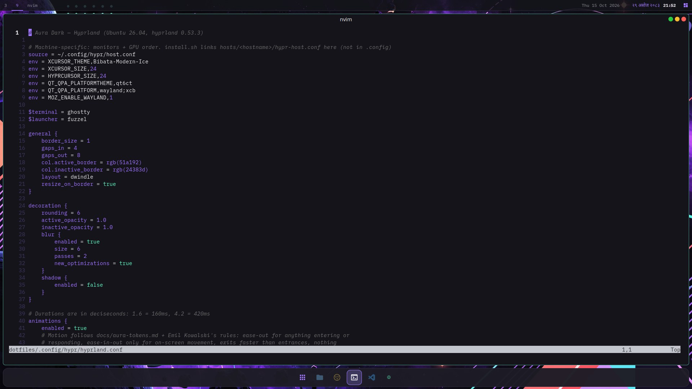
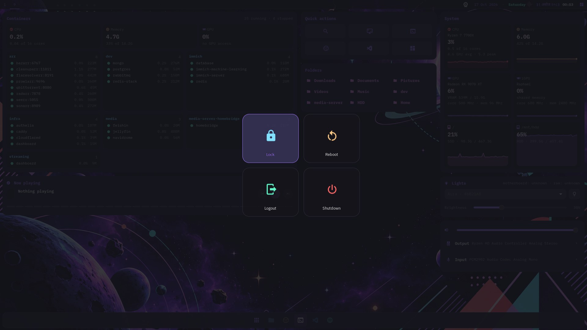
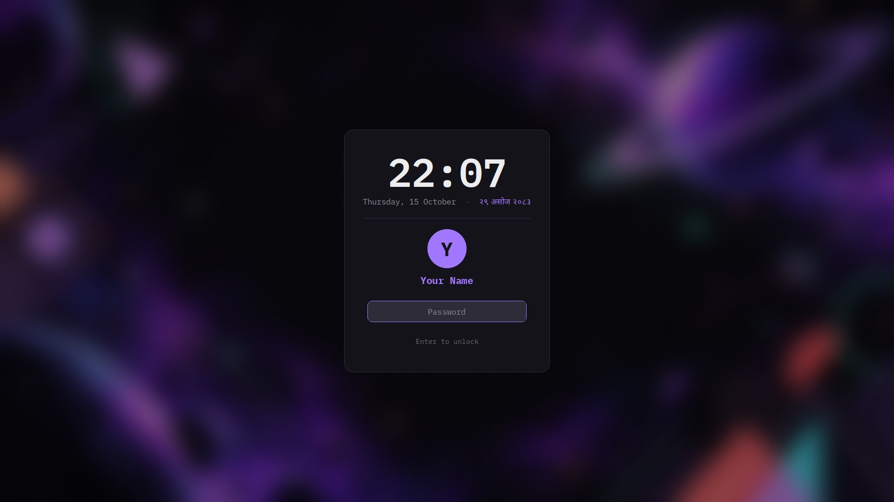

# dotfiles

Ubuntu 26.04 · GNOME 50 + Hyprland 0.53 · **Aura Dark**



| | |
|---|---|
|  |  |
| **aura-panel**: power, monitor, network, Bluetooth, notifications | **vicinae** launcher (Alt+Space) |
|  |  |
| **Ghostty** + Neovim (Aura port), titlebar traffic lights | **wlogout** power menu (Super+Esc) |
|  | |
| **hyprlock**: Aura card, English + Nepali (BS) date | |

## Fresh setup

```bash
git clone https://github.com/kshitizwagle/dotfiles.git ~/dotfiles && cd ~/dotfiles
scripts/packages.sh      # apt packages + BlexMono Nerd Font (sudo)
./install.sh             # symlink configs into $HOME (backs up existing files)
scripts/gnome.sh         # GNOME settings + extensions
scripts/gdm-theme.sh     # Aura login screen (sudo)
scripts/refind-theme.sh  # rEFInd config + Aura boot theme (sudo)

# Hyprland bar and side panel (Rust)
cargo install --path .config/hypr/aura-bar   --root ~/.local
cargo install --path .config/hypr/aura-panel --root ~/.local
```

Run `./install.sh --dry-run` first to see what it will do.

- **New machine?** Add `hosts/$(hostname)/` first (monitors, GPU order). See `.claude/skills/new-machine`.
- **SSH:** `.ssh/config` is gitignored. On first install it's seeded from `.ssh/config.example`, so fill in your own hosts.
- **Wallpapers** live in `Pictures/wallpapers/` and are linked to `~/Pictures/wallpapers/`.
- Nothing hardcodes a username or home path, so it works under any account.

## What's here

| | |
|---|---|
| Terminal | Ghostty, Aura palette, BlexMono Nerd Font, iTerm-style keys |
| Shell | zsh + oh-my-zsh, starship prompt |
| Editor | Neovim with the official Aura port |
| GNOME | libadwaita recolored with CSS variables (no forced theme), Papirus-Dark, autohide dock |
| Hyprland | 1px accent borders, 6px radius, no window blur, aura-bar dock, aura-panel sidebar, vicinae, hyprlock/hypridle, wlogout |
| Login | Aura GDM theme built on Ubuntu's Yaru |
| Boot | rEFInd with a custom Aura theme |

## Keys

**Hyprland**
| Key | Action |
|---|---|
| Super+Enter | Ghostty |
| Super+Space | Launcher (fuzzel) |
| Alt+Space | vicinae |
| Super+D / Super+N | Side panel / notifications |
| Super+Alt+V | Clipboard history |
| Super+Shift+S / Print | Area screenshot to clipboard |
| Shift+Print | Area screenshot to ~/Pictures/Screenshots |
| Super+L | Lock |
| Super+Q | Close window |
| Super+Shift+E | Power menu (also Super+Esc) |

**Ghostty**
| Key | Action |
|---|---|
| Ctrl+T | New tab |
| Ctrl+Shift+W | Close tab |
| Ctrl+1…8 / Ctrl+9 | Go to tab / last tab |
| Ctrl+Shift+← / → | Previous / next tab |
| Ctrl+Shift+D / Ctrl+Alt+D | Split right / down |
| Ctrl+Alt+Arrows | Move between splits |
| Ctrl+Shift+Enter | Zoom split |
| F11 | Fullscreen |

Design spec: [docs/aura-tokens.md](docs/aura-tokens.md). Agent guide: [AGENTS.md](AGENTS.md). Credits: [docs/THIRD_PARTY.md](docs/THIRD_PARTY.md).
