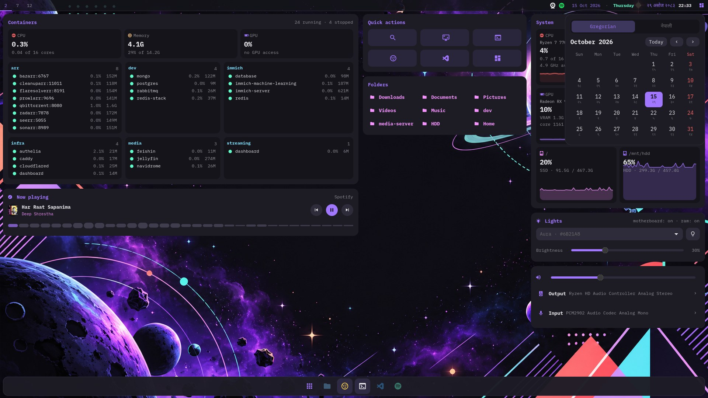

# dotfiles

Ubuntu 26.04 · GNOME 50 + Hyprland 0.53 · **Aura Dark**


The home screen: aura-panel's cards on the desktop layer (they sit under windows), the aura-bar dock, and the top bar with the English · weekday · Nepali date.

## Side panel

**aura-panel** (Super+D): power with confirmation, primary monitor, Ethernet / Wi-Fi / Bluetooth,
notification history and Do Not Disturb. The same panel's home-screen cards (Docker stacks, now playing
with a seekable spectrum bar, live CPU / memory / GPU / disk graphs, lights, sound) sit on the desktop.


## Calendar

Click the top-bar clock: a month view in **Gregorian** or **नेपाली** (Bikram Sambat) with the other
calendar's day under each date, previous/next month, Today, and Saturdays (Nepal's weekly holiday) in red.



## Launcher

**vicinae** (Alt+Space) in the Aura theme; Super+Alt+V shows clipboard history in the same window.


## Terminal

**Ghostty** with Neovim (the official Aura port), and macOS-style traffic-light titlebars from hyprbars.


## Power menu

**wlogout** (Super+Esc): a 2 × 2 grid of Aura cards over the blurred wallpaper.


## Lock screen

**hyprlock**: one Aura card with the time, the English · weekday · Nepali (BS) date, and an avatar
from `~/.face` (`.config/hypr/scripts/set-avatar.sh <picture>`), falling back to an initial.


## Fresh setup

```bash
git clone https://github.com/kshitizwagle/dotfiles.git ~/dotfiles && cd ~/dotfiles
scripts/packages.sh      # apt packages + BlexMono Nerd Font (sudo)
./install.sh             # symlink configs into $HOME (backs up existing files)
scripts/gnome.sh         # GNOME settings + extensions
scripts/gdm-theme.sh     # Aura login screen (sudo)
scripts/refind-theme.sh  # rEFInd config + Aura boot theme (sudo)

# Hyprland bar and side panel (Rust)
cargo install --path .config/hypr/aura-bar   --root ~/.local
cargo install --path .config/hypr/aura-panel --root ~/.local
```

Run `./install.sh --dry-run` first to see what it will do.

- **New machine?** Add `hosts/$(hostname)/` first (monitors, GPU order). See `.claude/skills/new-machine`.
- **SSH:** `.ssh/config` is gitignored. On first install it's seeded from `.ssh/config.example`, so fill in your own hosts.
- **Wallpapers** live in `Pictures/wallpapers/` and are linked to `~/Pictures/wallpapers/`. See the [wallpapers README](Pictures/wallpapers/README.md) for previews and how to switch them.
- Nothing hardcodes a username or home path, so it works under any account.

## What's here

| | |
|---|---|
| Terminal | Ghostty, Aura palette, BlexMono Nerd Font, iTerm-style keys |
| Shell | zsh + oh-my-zsh, starship prompt |
| Editor | Neovim with the official Aura port |
| GNOME | libadwaita recolored with CSS variables (no forced theme), Papirus-Dark, autohide dock |
| Hyprland | 1px accent borders, 6px radius, no window blur, aura-bar dock, aura-panel sidebar, vicinae, hyprlock/hypridle, wlogout |
| Login | Aura GDM theme built on Ubuntu's Yaru |
| Boot | rEFInd with a custom Aura theme |

## Keys

**Hyprland**
| Key | Action |
|---|---|
| Super+Enter | Ghostty |
| Super+Space | Launcher (fuzzel) |
| Alt+Space | vicinae |
| Super+D / Super+N | Side panel |
| Super+Alt+V | Clipboard history (in vicinae) |
| Super+1…5 | Go to workspace |
| Super+Shift+1…5 | Move window to workspace |
| Super+Shift+D | New workspace on this monitor |
| Super+Shift+← / → | Previous / next workspace on this monitor |
| Ctrl+Shift+M | Hide / show every window on this screen |
| Super+Shift+M | Bring back the last minimized window |
| Super+Shift+S / Print | Area screenshot to clipboard |
| Shift+Print | Area screenshot to ~/Pictures/Screenshots |
| Super+L | Lock |
| Super+Q | Close window (Spotify goes to the minimized stash and keeps playing in the background) |
| Super+Shift+E | Power menu (also Super+Esc) |

Titlebar buttons: red closes regular apps, yellow minimizes, and green gives the window its own workspace (press again to return).
For Spotify, red parks it in the minimized stash so playback continues in the background.

**Ghostty**
| Key | Action |
|---|---|
| Ctrl+T | New tab |
| Ctrl+Shift+W | Close tab |
| Ctrl+1…8 / Ctrl+9 | Go to tab / last tab |
| Ctrl+Tab | Next tab |
| Ctrl+Shift+Tab / Ctrl+Shift+← | Previous tab |
| Ctrl+Shift+→ / Ctrl+Shift+↓ | Split right / down |
| Ctrl+Alt+Arrows | Move between splits |
| Ctrl+Shift+Enter | Zoom split |
| Ctrl+V | Paste |
| F11 | Fullscreen |

Design spec: [docs/aura-tokens.md](docs/aura-tokens.md). Agent guide: [AGENTS.md](AGENTS.md). Credits: [docs/THIRD_PARTY.md](docs/THIRD_PARTY.md).
